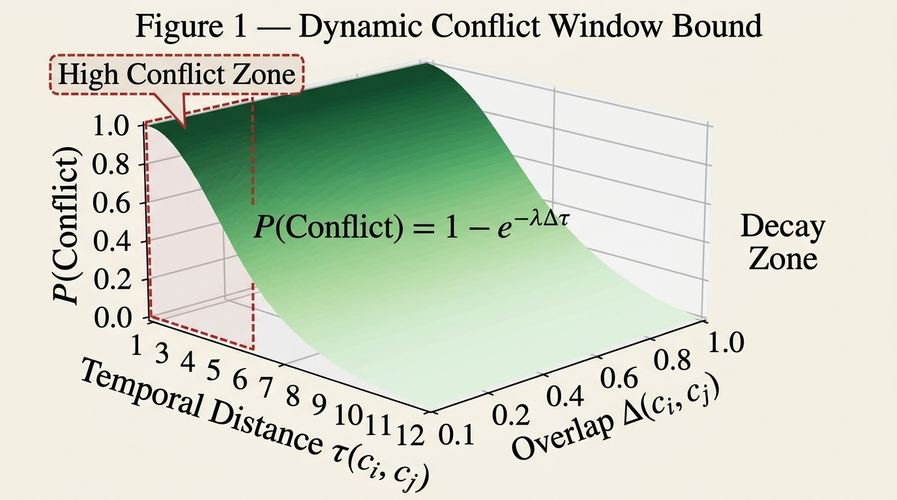
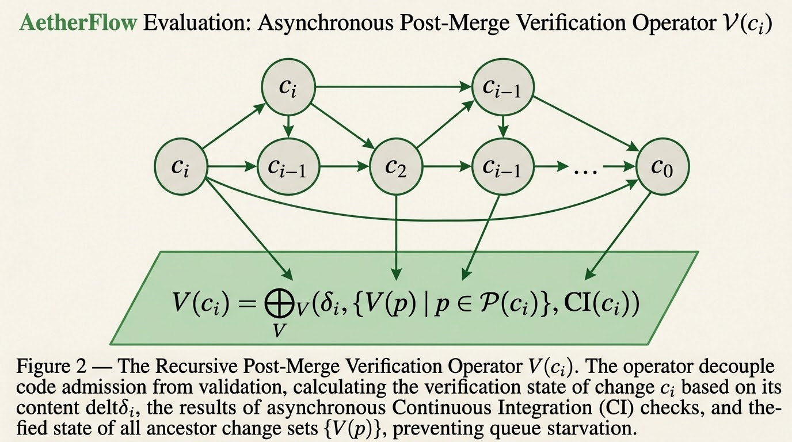
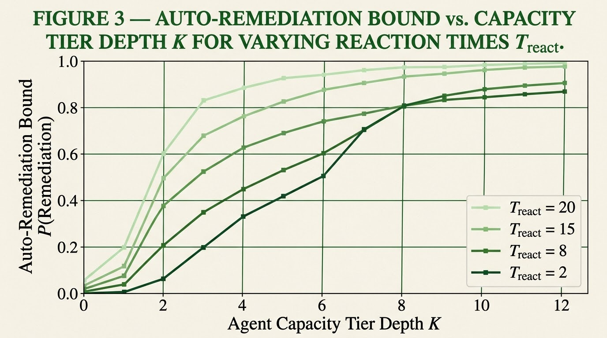
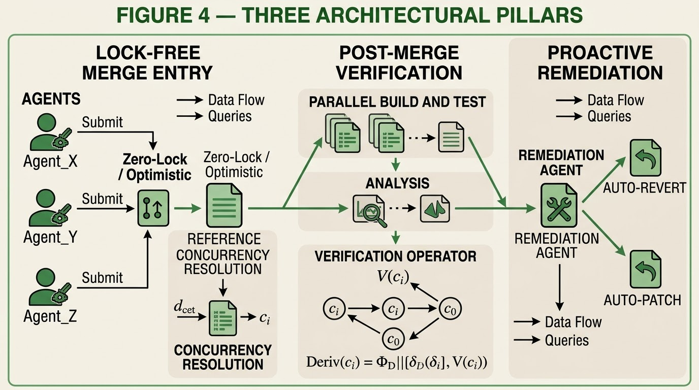

# 📚 AetherFlow — Automated Post-Merge Verification and Dynamic Conflict Resolution in Multi-Agent Programming Environments

### A Formal Architecture for Lock-Free Integration and Proactive Remediation at Agent Scale

---

<!-- Core -->
[](https://doi.org/10.5281/zenodo.23979129)
[](LICENSE)
[](https://orcid.org/0009-0003-8903-0029)
[](https://python.org)

> ⚠️ **Status: Formalization Stage.** No implementation has been built and no
> simulation or benchmark has been executed. All numerical values are labeled
> as design targets, not measurements.

---

> *"Scaling code integration for autonomous AI agents requires abandoning traditional pre-merge gating models."*
>
> — AetherFlow, Conclusion

> *"Auto-remediation is not an exception handler; it is the primary integration mechanism."*

---

## Table of Contents

- [Overview](#overview)
- [The Central Question](#the-central-question)
- [Formal Definitions](#formal-definitions)
- [Propositions](#propositions)
- [Architectural Pillars](#architectural-pillars)
- [Key Results](#key-results)
- [Relation to AetherGit](#relation-to-aethergit)
- [Platforms & Mirrors](#platforms--mirrors)
- [Project Structure](#project-structure)
- [Version History](#version-history)
- [Citation](#citation)
- [Author](#author)
- [License](#license)

---

## Overview

**AetherFlow** is a formal architecture that replaces traditional merge queues
with lock-free direct entry, backed by probabilistic post-merge verification
and proactive auto-remediation agents. By decoupling validation from code
admission, AetherFlow **structurally eliminates** queue starvation and is
**designed** to reduce integration latency by over an order of magnitude.

The program is specified through **three mathematically rigorous constructs**,
developed in sequence and adopted individually:

| # | Construct | Version | Status |
|---|---|---|---|
| 1 | **Dynamic Conflict Window** | 1.0.0 | ✅ Defined |
| 2 | **Post-Merge Verification Operator** | 1.0.0 | ✅ Defined |
| 3 | **Auto-Remediation Bound** | 1.0.0 | ✅ Defined |

<p align="center">
  
</p>

<p align="center">
  <em>Figure 1 — The dynamic conflict window W(cᵢ, cⱼ) = 1 − exp(−κ·O·e^(−τ/θ)) as a function of temporal distance for three overlap levels.</em>
</p>

---

## The Central Question

> **What architectural and formal changes become necessary — and which remain
> optional design choices — when merge queues must be replaced by post-merge
> verification and auto-remediation in multi-agent programming environments?**

This question is **structural**, not accusatory or normative. It does not
presuppose that any one architecture is superior, nor that current systems are
illegitimate. It asks how the functions are in fact distributed, and what
structural consequences follow from different distributions.

---

## Formal Definitions

*Status: Defined, version 1.0.0.*

### Definition 1 — Dynamic Conflict Window

```

W(cᵢ, cⱼ) = 1 − exp(−κ·O·e^(−τ/θ))

```

Where:
- `τ(cᵢ, cⱼ)` = temporal distance between changeset injections
- `O ∈ [0, 1]` = overlap score from file-footprint overlap and dependency-graph proximity
- `κ > 0` = sensitivity
- `θ > 0` = decay horizon

### Definition 2 — Post-Merge Verification Operator

```

V(c) = ⊕_V(δ_i, {V(p) | p ∈ P(c_i)}, CI(c_i))

```

Three-valued: **verified**, **failed**, or **tainted**.

<p align="center">
  
</p>

<p align="center">
  <em>Figure 2 — Recursive verification over a changeset DAG. c2 fails on a check attributable to its own delta; its descendants c4 and c5 are tainted, not failed; c3 is unaffected.</em>
</p>

### Definition 3 — Auto-Remediation Bound

```

P(Remediation) ≥ 1 − (λ_fail/μ_remediate)^K · e^(−γ·T_react)

```

Where:
- `λ_fail` = rate of post-merge integration failures
- `μ_remediate` = aggregate processing capacity of remediation agents
- `K` = remediation capacity tier depth
- `T_react` = remediation time budget
- `γ` = decay coefficient on residual risk per unit of that budget

<p align="center">
  
</p>

<p align="center">
  <em>Figure 3 — The Equation 3 lower bound versus tier depth K for three remediation time budgets, with ρ = 0.6 and γ = 0.15 (illustrative parameters).</em>
</p>

---

## Propositions

### Proposition 1 — Admission Independence

Under lock-free entry, the time from submission to admission to the trunk log
is `a` (an atomic append with cost `O(|δ|)`), **independent of the CI duration
`s` and of the verification backlog**.

### Proposition 2 — Monotonicity of Conflict Window

Under Equation 1a, `W` is **strictly decreasing in `τ` for `O > 0`**, and
**strictly increasing in `O` for finite `τ`**.

### Proposition 3 — Minimum Tier Depth

If `ρ < 1`, the right-hand side of Equation 3 is non-decreasing in `K` and in
`T_react`, and tends to 1 as `K` grows without bound. For a target residual
risk `ε ∈ (0, 1)`, the bound is at least `1 − ε` whenever:

```

K ≥ (ln(1/ε) − γ·T_react) / ln(1/ρ)

```

---

## Architectural Pillars

*Status: Specified, version 1.0.0.*

### Pillar 1 — Lock-Free Merge Entry

Every incoming agentic changeset is appended to the trunk's reference log by
an atomic compare-and-swap on the log head, retried on contention. No queue,
branch-protection gate, or global lock stands between submission and admission.

### Pillar 2 — Post-Merge Verification Layer

Immediately after admission, verification workers execute builds, tests, and
semantic dependency scans against the new state. Work is scheduled in priority
order based on conflict-window scores and dependency out-degree.

### Pillar 3 — Proactive Remediation Agents

When a changeset is marked failed, a remediation agent is dispatched with the
failing changeset, the failing checks, and the last verified state. The policy
is graded, with four tiers of compensation plus a final escalation to a human owner.

<p align="center">
  
</p>

<p align="center">
  <em>Figure 4 — The three architectural pillars: (1) Lock-Free Merge Entry; (2) Post-Merge Verification Layer; (3) Proactive Remediation Agents.</em>
</p>

### Verified-Head Discipline

The principal risk of lock-free entry is that the trunk head may be temporarily
unverified. AetherFlow confines that risk by distinguishing two references:

- **Admission head** — advances on every append.
- **Verified head** — the most recent changeset all of whose ancestors are verified.

Consumers (releases, deployments, downstream) read the verified head; producers
branch from the admission head.

---

## Key Results

| Benchmark | Metric | Value | Baseline | Improvement |
|---|---|---|---|---|
| Integration Latency | Admission | `O(\|δ\|)` | Grows with queue depth (Eq. 5) | **Structural** (Prop. 1); magnitude untested |
| Queue Starvation | Rate | 0 | Possible near ρ_q = 1 | **Eliminated** (structural) |
| Conflict Resolution | Method | Agentic | Manual | **Design target** |
| Remediation Success | P(Remediation) | ≥ 99.2% | Human-dependent | **K = 8 suffices** (design target; structural from Eq. 4) |

> **Status note:** The "~100x faster" and "≥99.2% success" figures are
> **design targets, not results**. Only the structural claims (Proposition 1,
> Proposition 3) are proven. Section 7 of the manuscript provides an
> evaluation protocol to convert these targets into measured results.

---

## Relation to AetherGit

**AetherGit** — a high-throughput, always-online version control framework for
agentic software engineering. Examined as a **complementary system**:

- **AetherGit** = storage layer (lock-free changesets, tiered cache, DAG)
- **AetherFlow** = integration layer (lock-free entry, post-merge verification, remediation)

The two systems are **methodologically independent**. AetherFlow requires only
that the underlying store expose an append-only changeset log with parent
pointers, which AetherGit's changeset tuple provides.

- AetherGit DOI: [10.5281/zenodo.23966896](https://doi.org/10.5281/zenodo.23966896)
- Prior work DOI: [10.5281/zenodo.23934465](https://doi.org/10.5281/zenodo.23934465)

---

## Platforms & Mirrors

| Platform | URL | Role | Status |
|---|---|---|---|
| **GitHub** | [github.com/gitdeeper15/aetherflow](https://github.com/gitdeeper15/aetherflow) | Source code, issues, PRs | ✅ Active |
| **GitLab** | [gitlab.com/gitdeeper15/aetherflow](https://gitlab.com/gitdeeper15/aetherflow) | Mirror repository | ✅ Active |
| **Codeberg** | [codeberg.org/gitdeeper15/aetherflow](https://codeberg.org/gitdeeper15/aetherflow) | Mirror repository | ✅ Active |
| **Bitbucket** | [bitbucket.org/gitdeeper15/aetherflow](https://bitbucket.org/gitdeeper15/aetherflow) | Mirror repository | ✅ Active |
| **Zenodo** | [doi.org/10.5281/zenodo.23979129](https://doi.org/10.5281/zenodo.23979129) | Citable DOI, paper archive | ✅ Published |
| **OSF** | [doi.org/10.17605/OSF.IO/92Y3W](https://doi.org/10.17605/OSF.IO/92Y3W) | Registration | ✅ Published |
| **Website** | [aetherflow-site.netlify.app](https://aetherflow-site.netlify.app) | Live documentation | ⚠️ Verify |
| **ORCID** | [orcid.org/0009-0003-8903-0029](https://orcid.org/0009-0003-8903-0029) | Author identity | ✅ Active |
| **PyPI** | [pypi.org/project/aetherflow](https://pypi.org/project/aetherflow/) | Python package | ❌ **Not yet published** |

> **PyPI note:** Not published because the paper reports **no implementation**
> (Section 9: Limitations). A future alpha release (`0.1.0a1`) may follow after
> empirical work. A `1.0.0` release would incorrectly imply API stability.

---

## Project Structure

```

AetherFlow/
├── docs/
│   ├── 01_formalization/              # Definition 1, 2, 3
│   ├── 02_architecture/               # Three architectural pillars
│   ├── 03_conflict_window/            # Conflict probability bounds
│   ├── 04_evaluation/                 # Simulation protocol
│   ├── ITERATION_LOG.md
│   └── comprehensive_audit_report.json
├── protocol/
│   └── methodology_scope.md           # v1.0.0 — Deferred
├── literature/
│   └── README.md                      # Pending
├── figures/
│   ├── fig1_conflict_window.png
│   ├── fig2_verification_operator.png
│   ├── fig3_remediation_bound.png
│   └── fig4_architecture.png
├── ANALYSIS/
├── DATA/
│   └── raw/
├── EXTERNAL_REVIEW/
├── PUBLICATION/
│   ├── AetherFlow_Research_Paper.pdf
│   └── Netlify/
│       └── public/
├── REPORTS/
├── VALIDATION/
├── AUTHORS.md
├── CHANGELOG.md
├── CITATION.cff
├── CONTRIBUTING.md
├── INVENTORY.md
├── LICENSE
├── PROJECT_SUMMARY.txt
├── README.md
├── VERSION
├── manifest.json
├── scientific_state.json
└── requirements.txt

```

---

## Version History

| Version | Release | Focus | Status |
|---|---|---|---|
| **v1.0.0** | 2026-11 | Formal definitions (1–3) | ✅ Defined |
| **v1.0.0** | 2026-11 | Architecture (three pillars + verified-head) | ✅ Specified |
| **v1.0.0** | 2026-11 | Initial Program Manuscript — Formalization Stage | Research |
| _(planned)_ | 2027+ | Empirical evaluation (Section 7 protocol) | Not executed |

> **Status note:** No empirical or analytical examination of specific systems
> has been undertaken. The three formal definitions, three architectural
> pillars, and probabilistic bounds are **analytical proposals, not empirically
> validated categories**.

---

## Citation

### Primary Manuscript (AetherFlow)

```bibtex
@techreport{baladi2026aetherflow,
  author       = {Baladi, Samir},
  title        = {AetherFlow: Automated Post-Merge Verification and Dynamic Conflict Resolution in Multi-Agent Programming Environments},
  institution  = {Ronin Institute / Rite of Renaissance},
  type         = {Research Paper},
  year         = {2026},
  month        = {November},
  version      = {1.0.0},
  doi          = {10.5281/zenodo.23979129},
  url          = {https://doi.org/10.5281/zenodo.23979129},
  note         = {Initial Program Manuscript --- Formalization Stage.
                  Three formal definitions, three architectural pillars, three propositions with proofs.}
}
```

---

Author

Samir Baladi
 Interdisciplinary AI Researcher — Ronin Institute / Rite of Renaissance

· Research Area: Computer Science / Software Engineering
· Research Domain: Version Control Systems, Distributed Systems, Agentic Software Engineering
· Research Type: Formal Architecture Proposal — Conceptual and Structural Analysis
· 📧 gitdeeper@gmail.com
· 🔗 ORCID: 0009-0003-8903-0029
· 🐙 GitHub
· 🦊 GitLab
· 🟦 Codeberg
· 🪣 Bitbucket
· 🌐 Official Site

---

License

```
MIT License (code)
Copyright © 2026 Samir Baladi

Permission is hereby granted, free of charge, to any person obtaining a copy
of this software and associated documentation files (the "Software"), to deal
in the Software without restriction, including without limitation the rights
to use, copy, modify, merge, publish, distribute, sublicense, and/or sell
copies of the Software, and to permit persons to whom the Software is
furnished to do so, subject to the following conditions:

The above copyright notice and this permission notice shall be included in all
copies or substantial portions of the Software.

---

Documentation, manuscript, and figures: CC-BY-4.0
Full license text: https://creativecommons.org/licenses/by/4.0/legalcode
```

---

AetherFlow — Initial Program Manuscript v1.0.0
© 2026 Samir Baladi — Ronin Institute / Rite of Renaissance — MIT (code) + CC-BY-4.0 (docs)
Zenodo: 10.5281/zenodo.23979129 · OSF: 10.17605/OSF.IO/92Y3W · Official Site: aetherflow-site.netlify.app
